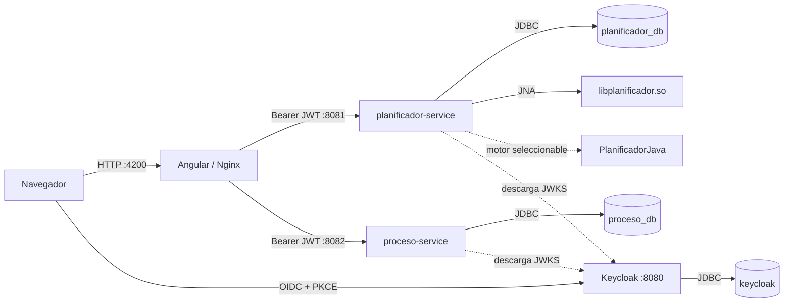

# ADD — arquitectura implementada

**Actualizado:** 2026-11-16. Este documento describe el sistema que existe en el repositorio y las verificaciones ejecutadas. No sustituye aprobaciones del docente ni presenta como completas las evidencias que requieren participantes reales.

## 1. Propósito y alcance

La aplicación permite construir y guardar conjuntos de procesos, simular cuatro algoritmos de CPU, visualizar intervalos de ejecución/ocio y comparar métricas. El sistema no ejecuta procesos reales del sistema operativo.

La arquitectura desplegada tiene un frontend Angular, exactamente dos microservicios Spring Boot, PostgreSQL y Keycloak. No existe API Gateway. La comparación de algoritmos se realiza desde Angular mediante solicitudes de planificación separadas; no hay endpoint `/comparaciones`.

## 2. Drivers y restricciones

- **Reglas funcionales:** FCFS, SJF no expulsivo, SRTF expulsivo y Round Robin con quantum. Las reglas y desempates del equipo están en [native/README.md](../native/README.md). La aprobación del docente no se presume.
- **Seguridad:** Keycloak emite tokens OIDC con vida de 60 segundos; cada API valida el JWT y la autorización se aplica en el servidor.
- **Persistencia:** conjuntos/procesos e historial pertenecen a bases separadas, una por microservicio.
- **Desempeño:** el motor C compartido se consume con JNA. Un motor Java equivalente permite comparación directa.
- **Despliegue:** Swarm empaqueta los cinco servicios con cuotas de recursos, secretos y volumen PostgreSQL persistente.
- **Restricción de plataforma:** `libplanificador.so` requiere Linux de 64 bits. La imagen `planificador-service` compila la biblioteca y la JVM durante la construcción; el runtime no contiene GCC.

## 3. Vista de despliegue y comunicación

En Swarm los cinco servicios se conectan a una red overlay. PostgreSQL no publica su puerto; los demás servicios publican 4200, 8080, 8081 y 8082 para la demostración local. El frontend usa direcciones `localhost`, por lo que este manifiesto es para una sola máquina de desarrollo, no para exposición remota.

## 4. Componentes y responsabilidades

| Componente | Responsabilidad y datos propios | Interfaces/dependencias |
|---|---|---|
| `frontend/` | Captura/valida entradas, inicia sesión, presenta conjuntos, Gantt, métricas, comparación e historial. No calcula la planificación ni los promedios. | Keycloak; `proceso-service`; `planificador-service`. |
| `proceso-service` | Crea, consulta y elimina conjuntos y procesos; los inserta en transacción y conserva la posición de entrada. | REST `/conjuntos`; PostgreSQL `proceso_db`; JWKS de Keycloak. |
| `planificador-service` | Lista algoritmos, planifica y guarda/consulta historial filtrado por propietario (`sub`). | REST `/algoritmos`, `/planificaciones`, `/historial`; PostgreSQL `planificador_db`; JNA o Java; JWKS. |
| `native/` | Implementa los cuatro algoritmos y la ABI C v1. Devuelve segmentos y métricas en orden de entrada. | Biblioteca `libplanificador.so`, consumida solo por el adaptador JNA. |
| Motor Java | Implementa los mismos cuatro algoritmos y permite comparación de resultados/tiempos. | `PLANIFICADOR_MOTOR=java`; por defecto se selecciona `nativo`. |
| Keycloak | Identidades, realm `planificador-realm`, cliente público Angular y roles `estudiante`/`docente`. | OIDC estándar, PKCE S256, token JWT y JWKS. |
| PostgreSQL | `proceso_db`: conjuntos/procesos. `planificador_db`: historial. `keycloak`: estado de identidad. | PostgreSQL 16; esquemas de aplicación inicializados al arrancar cada servicio. |
| `infra/swarm/` | Construye/despliega las imágenes, crea secretos Docker y conserva la base Swarm en su propio volumen. | Docker Swarm, red overlay y límites documentados en `stack.yml`. |

## 5. Flujos y contratos

1. Angular inicia OIDC con flujo estándar y PKCE S256. El interceptor adjunta el access token solo a solicitudes dirigidas a los dos servicios.
2. El usuario consulta/crea conjuntos en `proceso-service`. El servicio recibe la carga y la persiste; no hay comunicación directa entre microservicios.
3. Angular envía al planificador los procesos de la corrida. `planificador-service` valida entrada, selecciona el motor y devuelve segmentos, métricas y promedios.
4. El planificador guarda un snapshot del resultado con algoritmo, entrada, fecha y `sub`. Listar/buscar historial siempre filtra por el `sub` del JWT.
5. Para comparar, Angular ejecuta las cuatro planificaciones sobre la misma entrada y calcula ganadores visuales a partir de los promedios recibidos.

Rutas actuales:

- `proceso-service`: `GET/POST /conjuntos`, `GET /conjuntos/{id}`, `DELETE /conjuntos/{id}`.
- `planificador-service`: `GET /algoritmos`, `POST /planificaciones`, `GET /historial`, `GET /historial/{planificacionId}`.

Los modelos y respuestas están descritos en [OpenAPI](openapi.yaml). El contrato nativo y sus códigos de estado están en `native/include/planificador.h` y [README.md](../README.md). Las estructuras de proceso, segmento y métrica ocupan 32 bytes en Linux x86-64; la estructura del catálogo ocupa 84 bytes. La ABI v1 realiza sondeo de capacidades seguido de ejecución y no entrega resultados parciales por falta de capacidad.

## 6. Seguridad y límites operativos

- Ambos servicios validan firma con claves JWKS de Keycloak, emisor, expiración, `sub` no vacío y audiencia específica del servicio.
- Todos los endpoints requieren autenticación. En `proceso-service`, crear/eliminar conjuntos requiere `ROLE_docente`; las consultas requieren un JWT válido. En `planificador-service`, todos los endpoints requieren autenticación.
- Los endpoints devuelven JSON 401/403; CORS admite orígenes explícitos y rechaza `*`. La API es stateless y usa Bearer JWT.
- El realm limita los access tokens a 60 segundos; Angular solicita renovación cuando quedan menos de 30 segundos y maneja el evento de expiración/logout.
- Swarm monta passwords como secretos Docker. La imagen del motor nativo compila `libplanificador.so`; las imágenes runtime de Java no incluyen compilador C.
- El stack actual usa Keycloak `start-dev` y HTTP, y expone puertos de desarrollo. Es apropiado para demostración local; no incluye TLS, dominio, respaldos ni endurecimiento de producción.

## 7. Calidad y evidencia disponible

- Swarm se inició desde un volumen PostgreSQL nuevo. Los cinco servicios quedaron `1/1`; se crearon `keycloak`, `proceso_db` y `planificador_db`, y se importó `planificador-realm`.
- Verificación HTTP del despliegue: Angular `200`; documento OIDC del realm `200`; ambas APIs `401` sin token. Esto confirma el rechazo anónimo, no reemplaza una prueba completa con JWT y roles.
- Web 2: 960 comparaciones C/JNA-Java, y Arquitectura: 10; todas las salidas coincidieron exactamente. La repetición Swarm usó contenedores limitados a 0,75 CPU/768 MiB. Datos y metodología: [tests/benchmarks/README.md](../tests/benchmarks/README.md).
- Imagen runtime del planificador: 128.252.783–128.252.846 bytes en tres construcciones sin caché; GCC ausente. Mediana de construcción 80,656 s. El runner de Arquitectura produjo su primera salida en como máximo 8,098 s con los límites Swarm. El servicio planificador estuvo listo 22,838 s después de iniciar su contenedor en el despliegue desde volumen nuevo. Esta última es una sola observación, no una mediana ni una solicitud HTTP autenticada.
- Keycloak usa configuración preconstruida. En una actualización del servicio sobre PostgreSQL ya inicializado, el contenedor escuchó en 56,778 s. No es una medición de inicialización de base/realm desde cero ni del arranque conjunto del stack.
- Los seis controles académicos manuales permanecen pendientes por decisión del usuario.
- La prueba RQ-03 de usabilidad exige tres personas ajenas al equipo, tarea de cinco procesos, máximo 12 interacciones y 5 minutos, y cero preguntas. No hay sesiones registradas; no se inventan sus resultados.
- La comprobación integral de JWT válido/expirado, autorización docente/estudiante, aislamiento entre usuarios y el flujo de Atrás tras logout todavía requiere evidencia funcional registrada.

## 8. Decisiones vigentes y asuntos por confirmar

**Vigentes en la implementación:** dos microservicios; sin API Gateway; `proceso-service` posee conjuntos; `planificador-service` posee historial; Angular transmite la carga del conjunto a la operación de planificación; la selección nativo/Java es configuración; Web 2 y Arquitectura mantienen bancos separados; Docker Swarm es el despliegue demostrado.

**Por confirmar con el docente/equipo:**

1. Los documentos académicos deben cotejarse sobre el mínimo general de tres microservicios frente a los dos servicios específicos implementados; no se añade un tercer servicio sin resolver esa discrepancia.
2. Confirmación docente de desempates, ABI C/JNA y protocolos de medición.
3. Evidencias reales de usabilidad y de seguridad funcional descritas arriba.
4. Completar mediciones de tamaño de las demás imágenes y arranque en frío del sistema completo. El requisito de imagen/compilaciones del planificador está medido; la cota de 8,098 s corresponde al motor directo.
5. Documentar anexos, actualizar bitácora y preparar sustentación.

## 9. Referencias de implementación

- [Resumen de continuidad](resumen-contexto.md) y [auditoría de requisitos](auditoria-requisitos.md).
- [Infraestructura local y Swarm](../infra/README.md).
- [Bancos de medición y datos](../tests/benchmarks/README.md).
- [Reglas y pruebas del núcleo](../native/README.md).
- [Contrato OpenAPI](openapi.yaml).
